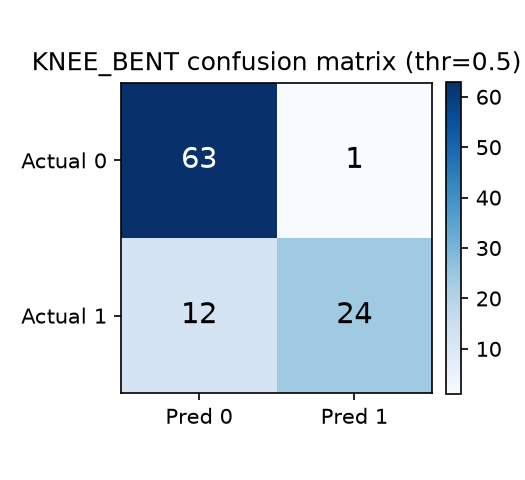
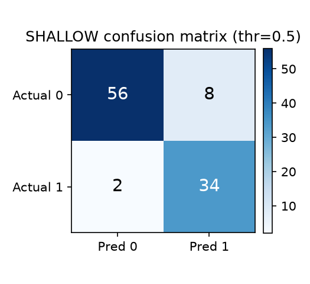

# Leg-Raise CNN-LSTM — Results Report

Multi-label fault classifier (`KNEE_BENT`, `SHALLOW`) for the Side Leg Raise exercise. This report
covers the trained model at `models/legraise_cnn_lstm.keras`. All metrics below were **recomputed
directly from the saved model and saved test arrays** (not retrained, not modified) — see
[Section 7](#7-reproducibility) for the exact method. Recomputation matched `models/legraise_metrics.json`
**exactly, with zero discrepancies** (see the note in Section 3).

---

## 1. Dataset summary

**Split:** train = Furqan, Subhan, Tashfeen (subject-grouped, whole subjects only); test = Mujtaba,
Rohail (fully held out — never seen during training or validation).

| Subject | Split | Sessions | Fault types recorded | Completed reps recorded |
|---|---|---|---|---|
| Furqan | train | 4 | none, knee_bent (x2), shallow | 64 |
| Subhan | train | 4 | none, knee_bent (x2), shallow | 64 |
| Tashfeen | train | 4 | none, knee_bent (x2), shallow | 67 |
| Mujtaba | test | 3 | none, knee_bent, shallow | 48 |
| Rohail | test | 3 | none, knee_bent, shallow | 52 |

**Session detail:**

| Filename | Subject | Fault type | Completed reps | Feature-quality median |
|---|---|---|---|---|
| Furqan_07-08-2026_12-34-13PM | Furqan | none | 16 | 0.987 |
| Furqan_07-08-2026_02-51-56PM | Furqan | knee_bent | 16 | 0.988 |
| Furqan_07-08-2026_03-11-36PM | Furqan | shallow | 16 | 0.989 |
| Furqan_13-08-2026_09-39-30PM | Furqan | knee_bent | 16 | 0.987 |
| Subhan_07-08-2026_08-25-38PM | Subhan | none | 16 | 0.990 |
| Subhan_07-08-2026_08-35-59PM | Subhan | knee_bent | 16 | 0.976 |
| Subhan_07-08-2026_08-45-59PM | Subhan | shallow | 16 | 0.983 |
| Subhan_14-08-2026_03-28-33PM | Subhan | knee_bent | 16 | 0.955 |
| Tashfeen_07-08-2026_01-11-12PM | Tashfeen | none | 16 | 0.983 |
| Tashfeen_07-08-2026_01-21-46PM | Tashfeen | shallow | 17 | 0.979 |
| Tashfeen_07-08-2026_01-33-57PM | Tashfeen | knee_bent | 16 | 0.978 |
| Tashfeen_14-08-2026_03-17-39PM | Tashfeen | knee_bent | 18 | 0.961 |
| Mujtaba_06-08-2026_11-00-40PM | Mujtaba | none | 16 | 0.977 |
| Mujtaba_08-08-2026_12-49-13PM | Mujtaba | shallow | 16 | 0.971 |
| Mujtaba_16-08-2026_09-46-11PM | Mujtaba | knee_bent | 16 | 0.976 |
| Rohail_14-08-2026_03-35-27PM | Rohail | none | 16 | 0.905 |
| Rohail_14-08-2026_03-44-00PM | Rohail | shallow | 18 | 0.955 |
| Rohail_14-08-2026_04-00-59PM | Rohail | knee_bent | 18 | 0.962 |

**Totals:**

- Total completed reps across all 18 sessions: **295**
- Dropped as degraded (< 8 valid frames after the 0.5 feature-quality floor): **0**
- Train reps (pre-augmentation): **195** | Test reps: **100**

**Per-label positive counts (pre-augmentation):**

| | KNEE_BENT=1 | SHALLOW=1 | clean [0,0] | both [1,1] |
|---|---|---|---|---|
| Train (195 reps) | 103 | 55 | 48 | 11 |
| Test (100 reps) | 36 | 36 | 32 | 4 |

**Windowing / features:**

- Window length: **32** frames (reps run ~13–23 frames; centered-truncate if longer, end-pad with zeros if shorter)
- Feature vector: **22** biomechanical features (joint angles, symmetry, scale-invariant geometry) + **22** parallel confidence values = **44** input channels per timestep
- Augmentation (train split only): mirror + time-warp + noise, applied per sample → **4.00x** (195 → 780 rows). Test split is never augmented.

---

## 2. Model architecture

```
Model: "legraise_cnn_lstm"
+--------------------------------------------------------------------------+
| Layer (type)        | Output Shape      |    Param # | Connected to      |
|---------------------+-------------------+------------+-------------------|
| features            | (None, 32, 44)    |          0 | -                 |
| (InputLayer)        |                   |            |                   |
|---------------------+-------------------+------------+-------------------|
| mask (InputLayer)   | (None, 32)        |          0 | -                 |
|---------------------+-------------------+------------+-------------------|
| mask_multiply       | (None, 32, 44)    |          0 | features[0][0],   |
| (MaskMultiply)      |                   |            | mask[0][0]        |
|---------------------+-------------------+------------+-------------------|
| conv1d (Conv1D)     | (None, 32, 32)    |      4,256 | mask_multiply[0]  |
|---------------------+-------------------+------------+-------------------|
| batch_normalization | (None, 32, 32)    |        128 | conv1d[0][0]      |
| (BatchNormalization)|                   |            |                   |
|---------------------+-------------------+------------+-------------------|
| conv1d_1 (Conv1D)   | (None, 32, 32)    |      3,104 | batch_normalizat  |
|---------------------+-------------------+------------+-------------------|
| mask_multiply_1     | (None, 32, 32)    |          0 | conv1d_1[0][0],   |
| (MaskMultiply)      |                   |            | mask[0][0]        |
|---------------------+-------------------+------------+-------------------|
| max_pooling1d       | (None, 16, 32)    |          0 | mask_multiply_1[0]|
| (MaxPooling1D)      |                   |            |                   |
|---------------------+-------------------+------------+-------------------|
| pool_mask           | (None, 16)        |          0 | mask[0][0]        |
| (PoolMask)          |                   |            |                   |
|---------------------+-------------------+------------+-------------------|
| bidirectional       | (None, 64)        |     16,640 | max_pooling1d[0], |
| (Bidirectional LSTM)|                   |            | pool_mask[0][0]   |
|---------------------+-------------------+------------+-------------------|
| dropout (Dropout)   | (None, 64)        |          0 | bidirectional[0]  |
|---------------------+-------------------+------------+-------------------|
| dense (Dense)       | (None, 32)        |      2,080 | dropout[0][0]     |
|---------------------+-------------------+------------+-------------------|
| dropout_1 (Dropout) | (None, 32)        |          0 | dense[0][0]       |
|---------------------+-------------------+------------+-------------------|
| dense_1 (Dense)     | (None, 2)         |         66 | dropout_1[0][0]   |
+--------------------------------------------------------------------------+
 Total params: 26,274 (102.63 KB)
 Trainable params: 26,210 (102.38 KB)
 Non-trainable params: 64 (256.00 B)
```

**Design notes:**

- **Hand-carried masking**: padded timesteps make up a large fraction of the 32-frame window (real
  reps are 13–23 frames). Keras's automatic mask propagation from a `Masking` layer does not survive
  `Conv1D`/`BatchNormalization`/`MaxPooling1D`, and `Conv1D`'s bias can turn zero-padded timesteps
  non-zero. `MaskMultiply` re-zeroes padding after the conv block; `PoolMask` downsamples the mask to
  match `MaxPooling1D(2)`'s halved timestep count, and the LSTM receives that mask explicitly.
- **Linear output, manual sigmoid**: the final `Dense(2)` layer has **no activation** — the model
  outputs raw logits, not probabilities. This is a deliberate consequence of using
  `tf.nn.weighted_cross_entropy_with_logits` for the per-label class-imbalance weighting (below),
  which requires logits to stay numerically stable. Sigmoid is applied by hand at evaluation/inference
  time (`1 / (1 + exp(-logit))`).
- **Two independent sigmoid outputs** (not softmax): `[KNEE_BENT, SHALLOW]` are scored independently
  per rep — a rep can be flagged for both, one, or neither.

**Loss & optimization:**

| | |
|---|---|
| Loss | Weighted binary cross-entropy on logits (`tf.nn.weighted_cross_entropy_with_logits`), per-label `pos_weight`, averaged across labels then batch |
| pos_weight (KNEE_BENT) | **0.9104** (computed as num_negative/num_positive = 244/268 on the actual train-fit rows, post val-split, post-augmentation) |
| pos_weight (SHALLOW) | **2.5556** (368/144) |
| Optimizer | Adam, learning rate 1e-3 |
| Batch size | 16 |
| Max epochs | 150 (early-stopped at 22) |
| Early stopping | monitor=`val_loss`, patience=15, `restore_best_weights=True` |
| Seed | 42 (`random`, `numpy`, `keras.utils.set_random_seed`) |
| Validation subject | **Tashfeen** (held out from TRAIN, subject-grouped — 268 of the 780 augmented train rows; remaining 512 rows are the actual train-fit set) |
| Normalization | Per-channel mean/std fit on TRAIN real (non-padded) frames only; applied unchanged to val/test |

---

## 3. Overall test metrics (100 reps, Mujtaba + Rohail combined)

> **Verification note:** all numbers in this section were recomputed independently from
> `models/legraise_cnn_lstm.keras` + `dataset/built/legraise/{X,y,mask,conf}_test.npy`, and compared
> field-by-field against the stored `models/legraise_metrics.json`. **Result: zero discrepancies** —
> every recomputed value matched the stored file exactly (floating-point tolerance 1e-6). The model
> and its recorded evaluation are internally consistent.

### KNEE_BENT (n_positive=36, n_negative=64)

**AUC: 0.9041**

| Threshold | Precision | Recall | F1 | TP | TN | FP | FN |
|---|---|---|---|---|---|---|---|
| 0.3 | 0.9615 | 0.6944 | 0.8065 | 25 | 63 | 1 | 11 |
| 0.5 | 0.9600 | 0.6667 | 0.7869 | 24 | 63 | 1 | 12 |
| 0.7 | 1.0000 | 0.6389 | 0.7797 | 23 | 64 | 0 | 13 |

**Confusion matrix at threshold 0.5:**

| | Predicted 0 | Predicted 1 |
|---|---|---|
| **Actual 0** | TN = 63 | FP = 1 |
| **Actual 1** | FN = 12 | TP = 24 |



### SHALLOW (n_positive=36, n_negative=64)

**AUC: 0.9870**

| Threshold | Precision | Recall | F1 | TP | TN | FP | FN |
|---|---|---|---|---|---|---|---|
| 0.3 | 0.7907 | 0.9444 | 0.8608 | 34 | 55 | 9 | 2 |
| 0.5 | 0.8095 | 0.9444 | 0.8718 | 34 | 56 | 8 | 2 |
| 0.7 | 0.8095 | 0.9444 | 0.8718 | 34 | 56 | 8 | 2 |

**Confusion matrix at threshold 0.5:**

| | Predicted 0 | Predicted 1 |
|---|---|---|
| **Actual 0** | TN = 56 | FP = 8 |
| **Actual 1** | FN = 2 | TP = 34 |



### Clean-rep detection (predicted [0,0], threshold 0.5)

n_true_clean = 32 (of 100 test reps)

| Precision | Recall | F1 | TP | TN | FP | FN |
|---|---|---|---|---|---|---|
| 0.7692 | 0.9375 | 0.8451 | 30 | 59 | 9 | 2 |

### Exact-match accuracy (both labels correct, threshold 0.5, strict)

**0.780** (78/100 reps have both KNEE_BENT and SHALLOW predicted correctly)

---

## 4. Per-subject breakdown — the key generalization result

Threshold 0.5. This is what a pooled test-set number cannot show: whether the model generalizes
across held-out *bodies*, not just held-out *reps*.

| Subject | Fault | Precision | Recall | F1 | TP | TN | FP | FN | n_positive / n_rows |
|---|---|---|---|---|---|---|---|---|---|
| **Mujtaba** | KNEE_BENT | 1.0000 | **0.5556** | 0.7143 | 10 | 30 | 0 | 8 | 18/48 |
| **Mujtaba** | SHALLOW | 0.8889 | 0.9412 | 0.9143 | 16 | 29 | 2 | 1 | 17/48 |
| **Rohail** | KNEE_BENT | 0.9333 | **0.7778** | 0.8485 | 14 | 33 | 1 | 4 | 18/52 |
| **Rohail** | SHALLOW | 0.7500 | 0.9474 | 0.8372 | 18 | 27 | 6 | 1 | 19/52 |

KNEE_BENT recall is markedly lower on Mujtaba (0.556) than Rohail (0.778) — see Section 6 for why,
and how this was diagnosed. SHALLOW recall is consistent across both subjects (~0.94), showing the
model generalizes well for that fault regardless of who is performing the rep.

---

## 5. Training behaviour

- **Epochs run:** 22 (of a max 150), stopped by `EarlyStopping(patience=15)` after no `val_loss`
  improvement for 15 consecutive epochs following the best epoch.
- **Best val_loss: 0.3851** at **epoch 7** — `restore_best_weights=True` means the *saved* model's
  weights are from epoch 7, not epoch 22.
- **Final train_loss (epoch 22): 0.00255**
- **Final val_loss (epoch 22, last logged, NOT the restored weights): 0.6971**

**Honest overfitting note:** train loss collapses from 0.68 → 0.003 by epoch ~20 while val loss,
after its epoch-7 minimum of 0.385, climbs back up into the 0.5–0.7 range and stays there — classic
small-dataset overfitting once the model has memorized the 512-row train-fit set. Early stopping with
`restore_best_weights=True` is what keeps the deployed model at its epoch-7 weights rather than the
badly-overfit epoch-22 weights; the fact that best val_loss occurs so early (epoch 7 of 22) is itself
a symptom of how little independent signal 512 rows (128 pre-augmentation reps from 2 train subjects)
provides.

**Training curve:** 

*(train_loss vs val_loss per epoch — see `models/legraise_training_curve.png` for the full plot;
`models/legraise_training_history.json` has the raw per-epoch values.)*

---

## 6. Notable findings / limitations

**The subtle-knee-bend diagnostic — an evaluation-methodology strength, not just a bug fix.** After
the initial round of training, the pooled KNEE_BENT recall (0.417) looked mediocre but plausible on
its own — nothing about the number screamed "broken." Only the per-subject breakdown (Section 4)
revealed the real picture: recall was 0.056 on Mujtaba (essentially never detecting her knee-bends)
against 0.778 on Rohail. A pooled metric alone would have hidden this. Investigating with a targeted
diagnostic — reconstructing the detector's own hip-knee-ankle angle formula per frame and finding the
minimum knee angle reached in each labelled KNEE_BENT rep — showed why: Mujtaba's original knee-bent
session (recorded before a "bend clearly" recording-protocol change) averaged only ~11.5° past the
168° straight-knee threshold, versus 25.6°–66.7° for every other subject in the dataset (train and
test alike). The model had essentially never seen a bend that subtle labelled as a fault. This was
confirmed as the actual cause (not a normalization or body-shape outlier effect — a parallel check
showed Mujtaba's knee-angle feature values were *not* distributional outliers vs. train; if anything
they sat nearer the center of the train distribution than the more extreme training examples).
Re-recording Mujtaba's knee-bent session at the same clear-bend standard as the rest of the dataset
(new session averaging ~24.7° past threshold) and retraining raised her KNEE_BENT recall from **0.056
to 0.556** — a 10x improvement — without moving SHALLOW recall on either subject. The residual gap
to Rohail's 0.778 is plausible given Mujtaba has zero KNEE_BENT training exposure (she's test-only)
while the model's whole KNEE_BENT concept was learned entirely from the three train subjects.

**Honest operating range.** The model is reliable on clear, unambiguous faults — SHALLOW recall is
~0.94 on both held-out subjects, and KNEE_BENT recall is strong (0.78) once bends are clearly past
threshold. It remains weaker on very subtle knee-bends near the 168° boundary. This is precisely why
the deployed system is a hybrid: the deterministic rule engine (`detectors/legraise.py`) still owns
all *live*, frame-level fault flagging (including subtle cases, since it's an exact threshold check
with no learned blind spot), while the model contributes graded per-rep quality scores and
session-level trend metrics the rule engine cannot produce.

**Small-data caveats.** This is a small, single-project dataset: 5 subjects total (3 train, 2 test),
295 completed reps before augmentation, 100 test reps. Two test subjects is enough to catch a
per-body generalization failure (as above) but not enough to generalize a recall estimate to a
broader population. The "both faults" test count (4 reps) is too small to draw any real conclusion
from. Training shows clear overfitting past epoch 7 (Section 5), mitigated but not eliminated by
early stopping. These results demonstrate the pipeline and the value of per-subject evaluation; they
are not a claim of production-grade robustness across a general population.

---

## 7. Reproducibility

- **Seed:** 42, applied to `random`, `numpy`, and `keras.utils.set_random_seed` before any data
  loading or model construction.
- **TensorFlow:** 2.18.1 / **Keras:** 3.15.1 (`venv-train`).
- **Regenerate the built arrays:** `venv-train\Scripts\python build_dataset.py` — reads
  `dataset/manifest.csv` + `dataset/legraise/*.jsonl`, writes
  `dataset/built/legraise/{X,y,mask,conf}_{train,test}.npy` + `label_names.json`.
- **Retrain:** `venv-train\Scripts\python train_model.py` — reads the built arrays, trains, writes
  `models/legraise_cnn_lstm.keras`, `legraise_norm_stats.npz`, `legraise_metrics.json`,
  `legraise_training_history.json`, `legraise_training_curve.png`.
- **Recompute metrics without retraining** (the method used for this report): load
  `models/legraise_cnn_lstm.keras` with `compile=False` (only the custom `MaskMultiply`/`PoolMask`
  layers need to be registered — the weighted-loss object is not needed for inference), build model
  inputs by normalizing `X_test.npy` with `legraise_norm_stats.npz`'s mean/std and concatenating with
  `conf_test.npy`, run a forward pass to get logits, apply sigmoid by hand, then compare against
  `y_test.npy` using the same `evaluate()`/`per_subject_breakdown()` functions defined in
  `train_model.py` (imported, not reimplemented, to guarantee identical methodology to the stored
  `legraise_metrics.json`).
